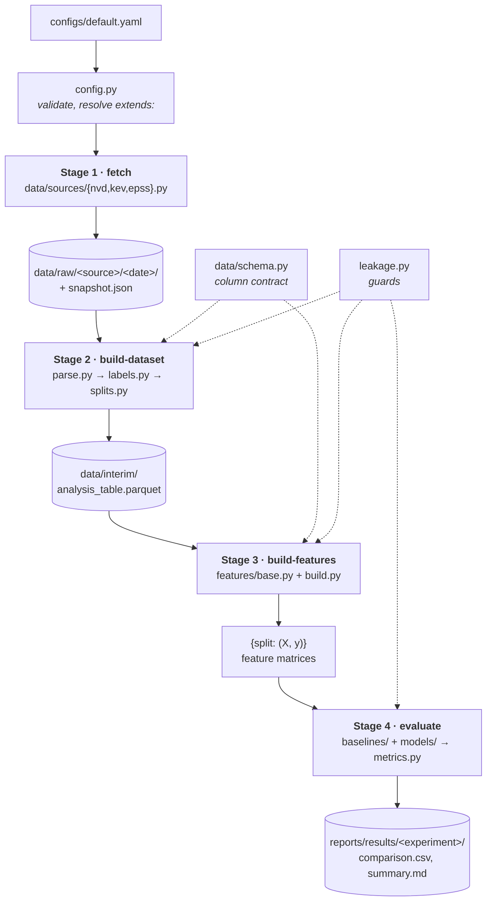

# Architecture and data flow

**The single file to read if you want to understand how the whole thing fits together.**

Companion documents: [project-spec.md](project-spec.md) says *what* the project does and why.
The [decision records](decisions/) say *why the design is shaped this way*. This file says
*how data moves through the code*.

---

## 1. The one-paragraph version

Four stages, each a CLI command, each writing to disk before the next one reads. Raw
vendor data comes down into `data/raw/`. It is parsed into one tidy table, labelled from
CISA KEV, and split by publication date. Feature blocks are fitted on the training rows
only and applied to every split. Rankers — baselines now, models later — turn a feature
matrix into one score per CVE. Metrics turn those scores into precision@k at a set of
patch budgets, with bootstrap intervals, and write a comparison table.

The stages are decoupled through the filesystem on purpose: `fetch` takes tens of minutes,
`evaluate` takes seconds, and you will run `evaluate` a hundred times.

---

## 2. The flow



If mermaid does not render for you, the same thing in plain text:

```
configs/default.yaml
   │  Config (validated, pydantic)
   ▼
[1] fetch          data/sources/{nvd,kev,epss}.py
   │               → data/raw/<source>/<date>/ + snapshot.json
   ▼
[2] build-dataset  parse.py → labels.py → splits.py
   │               → data/interim/analysis_table.parquet
   ▼
[3] build-features features/base.py + build.py
   │               → {split: (X, y)}
   ▼
[4] evaluate       baselines/ + models/ → evaluation/metrics.py → report.py
                   → reports/results/<experiment>/
```

---

## 3. Stage by stage

Each row names the artifact crossing the boundary and the invariant that must hold there.
If an invariant is violated, the stage should raise — never continue with bad data.

### Stage 1 — `fetch`

| | |
|---|---|
| **Command** | `vulnprio fetch` |
| **Entry point** | [cli.py:32](../src/vulnprio/cli.py#L32) |
| **Reads** | Config only. Plus `NVD_API_KEY` from `.env` if present. |
| **Files** | [data/sources/base.py](../src/vulnprio/data/sources/base.py), [nvd.py](../src/vulnprio/data/sources/nvd.py), [kev.py](../src/vulnprio/data/sources/kev.py), [epss.py](../src/vulnprio/data/sources/epss.py) |
| **Writes** | `data/raw/<source>/<date>/` — page JSON, catalogue JSON, or `.csv.gz` |
| **Invariant** | Every snapshot directory carries a `snapshot.json` manifest. A result is only reproducible against a *named* snapshot, because KEV and EPSS are living datasets. |

The `DataSource` ABC gives every source `snapshot_dir()`, `latest_snapshot()` and
`fetch(force=False)`. Re-running `fetch` on the same day reuses the existing snapshot
unless you pass `--force`.

### Stage 2 — `build-dataset`

| | |
|---|---|
| **Command** | `vulnprio build-dataset` |
| **Entry point** | [cli.py:41](../src/vulnprio/cli.py#L41) |
| **Reads** | The latest snapshot per source |
| **Files** | [parse.py](../src/vulnprio/data/parse.py) → [labels.py](../src/vulnprio/data/labels.py) → [splits.py](../src/vulnprio/data/splits.py), orchestrated by `data/build.py` |
| **Writes** | `data/interim/analysis_table.parquet` |
| **Invariant** | `assert_temporal_order(train, test)` — no training record may be newer than the oldest test record. |

Three sub-steps, in order:

1. **Parse.** Nested NVD JSON becomes one row per CVE, matching [schema.py](../src/vulnprio/data/schema.py).
   Rejected CVEs and CVEs without a CVSS v3.1 vector are dropped here.
2. **Label.** KEV membership becomes `exploited ∈ {0,1}`, frozen at `labels.observation_cutoff`.
   The merge uses `validate="one_to_one"` so a duplicate CVE ID crashes rather than
   silently inflating the positive count.
3. **Split.** `published_date` becomes `split ∈ {train, valid, test, excluded}`.
   Rows are marked `excluded`, never dropped, so `describe()` shows what the windowing cost.

> The label horizon deliberately extends **past** the test boundary. A CVE published in
> December 2023 and KEV-listed in March 2025 is a true positive for the 2023 test set.
> `Config` enforces `observation_cutoff >= test_end`. See [ADR 0002](decisions/0002-label-definition.md).

### Stage 3 — `build-features`

| | |
|---|---|
| **Command** | `vulnprio build-features` |
| **Entry point** | [cli.py:50](../src/vulnprio/cli.py#L50) |
| **Reads** | `data/interim/analysis_table.parquet` |
| **Files** | [features/base.py](../src/vulnprio/features/base.py), [build.py](../src/vulnprio/features/build.py), and one file per block |
| **Writes** | `{split: (X, y)}` in memory; `data/processed/` when cached |
| **Invariant** | `assert_no_forbidden_columns(X)` — `exploited`, `kev_date_added` and `split` must never reach a feature matrix. |

The critical property: **blocks are sklearn transformers**, so anything *fitted* — TF-IDF
vocabulary, CWE category levels, vendor frequencies — is fitted on `split == "train"` only,
then applied to valid and test. Fitting a vectoriser on the full corpus before splitting is
a leak, and this shape makes it hard to do by accident.

```
build_matrices(config)
    ├── read_analysis_table(config)
    ├── build_feature_blocks(config.features)   # registry lookup, config-driven
    ├── fit_transform(blocks, train, y_train)   # ← fits happen HERE and nowhere else
    └── transform(blocks, valid), transform(blocks, test)
```

### Stage 4 — `evaluate`

| | |
|---|---|
| **Command** | `vulnprio evaluate` |
| **Entry point** | [cli.py:59](../src/vulnprio/cli.py#L59) |
| **Reads** | The feature matrices from Stage 3 |
| **Files** | [evaluation/runner.py](../src/vulnprio/evaluation/), [metrics.py](../src/vulnprio/evaluation/metrics.py), [results.py](../src/vulnprio/evaluation/results.py), [report.py](../src/vulnprio/evaluation/report.py), [plots.py](../src/vulnprio/evaluation/plots.py) |
| **Writes** | `reports/results/<experiment>/` — per-ranker CSVs, `comparison.csv`, `summary.md`, `config.resolved.yaml` |
| **Invariant** | Every ranker in one table is scored under the **same** `tie_policy`. Mixing policies across rows makes the comparison meaningless. |

Data shape through this stage:

```
X_test, y_test
   │
   ▼  Ranker.score(X) → np.ndarray, one score per row, higher = patch sooner
   │
   ▼  evaluate_ranking(y, scores, k_percents) → DataFrame, one row per budget
   │
   ▼  RankerResult(name, scores, table, describe)
   │     └── scores kept alongside the table so bootstrap CIs, PR curves and
   │         gain curves never refit anything
   ▼
comparison_table(results, baseline="cvss") → rankers × budgets, with deltas
```

---

## 4. The three cross-cutting files

These are not stages. They are read *by* stages, and they are what actually couples the
modules together.

### `data/schema.py` — the column contract

The real spine of the project. Every stage from parsing onward reads column names from
here, so a parser change cannot silently break a feature block — the schema check fails
first.

If you want to know whether a change breaks something downstream, look here, **not** at
the import graph. `validate(frame, expected)` checks presence, not dtype: pandas dtype
inference is too loose for equality to be useful, but a missing column is always a real bug.

Read this file second, right after `config.py`. It is the shortest path to understanding
what the data actually looks like.

### `config.py` — one validated object per run

A run is fully described by `(raw snapshot, resolved config, seed)`. All three are recorded:
snapshots carry a manifest, and each run writes `config.resolved.yaml` beside its results.

Experiment configs `extends:` the base file and are **shallow-merged per top-level key**.
That is deliberate: a partially-overridden nested block is a common source of silent
misconfiguration, so an experiment must restate a whole block.

The cross-field validators are the interesting part — each one corresponds to a mistake
that would otherwise surface only as a suspiciously good result:

- `train_end < valid_end < test_end`
- `observation_cutoff >= test_end`
- `primary_k_percent` must appear in `k_percents`
- `extra="forbid"` — a typo'd key is an error, not a silently ignored setting

### `leakage.py` — the guards

Four named leaks, called at stage boundaries:

| Leak | Guard | Where |
|---|---|---|
| Temporal — training on future CVEs | `assert_temporal_order` | end of Stage 2 |
| Label-date — `kev_date_added` as a feature | `assert_no_forbidden_columns` | before every fit, Stage 3 |
| Description — text rewritten *after* exploitation | `scrub_series` + blocklist | inside the text block |
| Post-hoc references — links added after the fact | *not preventable* — mandatory ablation | reported both ways |

The fourth is the honest one. NVD serves current-state records and does not expose
historical field revisions, so leaks 3 and 4 are mitigated, not eliminated. Saying so is
part of the deliverable.

---

## 5. The two registries

Both use the same pattern: a decorator writes the class into a module-level dict, and
config names resolve through it.

| | Feature blocks | Rankers |
|---|---|---|
| **ABC** | `FeatureBlock` ([features/base.py](../src/vulnprio/features/base.py)) | `Ranker` ([models/base.py](../src/vulnprio/models/base.py)) |
| **Decorator** | `@register_block` | `@register_model` / `@register_baseline` |
| **Config key** | `features.blocks` | `models.enabled` / `baselines` |
| **Contract** | `fit` / `transform` / `feature_names` | `fit` / `score` |

**Baselines and models are separate registries on purpose.** They share the `Ranker`
interface — that is what forces the evaluation code to treat them identically. But a
baseline must not be *selectable* as a model, or `models.enabled: [cvss]` would silently
report a reference line as a result. Enforced by [tests/test_registries.py](../tests/test_registries.py).

Adding a feature block:

1. New file in `src/vulnprio/features/`, subclass `FeatureBlock`, add `@register_block`
2. Import it in `features/__init__.py` (for the registration side effect)
3. Add its name under `features.blocks` in config

Copy [features/cvss.py](../src/vulnprio/features/cvss.py) — it is the worked example.
Adding a model: see [models/README.md](../src/vulnprio/models/README.md).

---

## 6. Where state lives on disk

| Path | Committed? | Contents |
|---|---|---|
| `data/raw/` | No | Downloaded snapshots. Reproducible via `fetch`. |
| `data/interim/` | No | `analysis_table.parquet`. Deterministic from raw + config. |
| `data/processed/` | No | Cached feature matrices. |
| `data/external/` | **Yes** | Small hand-checked lookups, e.g. `cwe_categories.csv`. |
| `reports/figures/`, `reports/results/` | No | Generated output. |
| `configs/` | Yes | Base config + one file per experiment. |

Rule of thumb: if a file is a deterministic function of things already in git, it is
gitignored. `data/external/` is the exception because it is hand-curated, not derived.

---

## 7. Implementation status

The skeleton is complete; some stage bodies are still stubs. Every stub raises
`NotImplementedError` naming its plan task, so you always know where to look.

| Module | Status |
|---|---|
| `config.py`, `paths.py`, `logging_utils.py` | Complete |
| `data/schema.py`, `data/sources/base.py` | Complete |
| `data/labels.py`, `data/splits.py` | Complete |
| `leakage.py` | Complete |
| `features/base.py`, `features/cvss.py` | Complete |
| `models/base.py`, `baselines/registry.py` | Complete |
| `baselines/cvss.py`, `baselines/random_ranker.py` | Complete |
| `evaluation/metrics.py` | Complete **except `order_by_score`** — see below |
| `evaluation/results.py` | Complete |
| `data/sources/{nvd,kev,epss}.py` | Stub — plan Tasks 2–4 |
| `data/parse.py` | Stub — plan Task 5 |
| `data/build.py` | Not yet created — plan Task 6 |
| `features/{temporal,cwe,cpe,references,text}.py` | Stub — plan Tasks 7–11 |
| `features/build.py` | Partial — plan Task 12 |
| `eda.py` | Not yet created — plan Task 13 |
| `baselines/epss.py` | Stub — plan Task 14 |
| `evaluation/runner.py` | Not yet created — plan Task 15 |
| `evaluation/report.py`, `plots.py` | Stub — plan Tasks 16–17 |
| `cli.py` | Command surface complete; bodies wired per task |

**`order_by_score` is left deliberately unimplemented.** It decides what happens when two
CVEs have the same score — and CVSS scores clump hard, with tens of thousands sitting at
exactly 9.8. Since that is above the cut for any realistic patch budget, the policy changes
the reported baseline number by roughly a factor of two. It is a methodological decision,
not boilerplate. The failing tests in `tests/evaluation/test_metrics.py::TestTiePolicies`
are its specification. See [ADR 0004](decisions/0004-tie-breaking.md).

---

## 8. Suggested reading order

For someone joining the project cold, about 45 minutes:

1. [project-spec.md](project-spec.md) §1–3 — the research question and the data
2. [data/schema.py](../src/vulnprio/data/schema.py) — what a row actually looks like
3. [config.py](../src/vulnprio/config.py) — what a run is, and what cannot be misconfigured
4. This document, §3 — the four stages
5. [data/splits.py](../src/vulnprio/data/splits.py) and [ADR 0003](decisions/0003-temporal-split.md) — why the split is not random
6. [leakage.py](../src/vulnprio/leakage.py) — the four leaks
7. [features/cvss.py](../src/vulnprio/features/cvss.py) — the block pattern you will copy
8. [evaluation/metrics.py](../src/vulnprio/evaluation/metrics.py) and [ADR 0004](decisions/0004-tie-breaking.md) — how success is measured

Then run `vulnprio info` to see the config, blocks, models and baselines the code
currently resolves.
